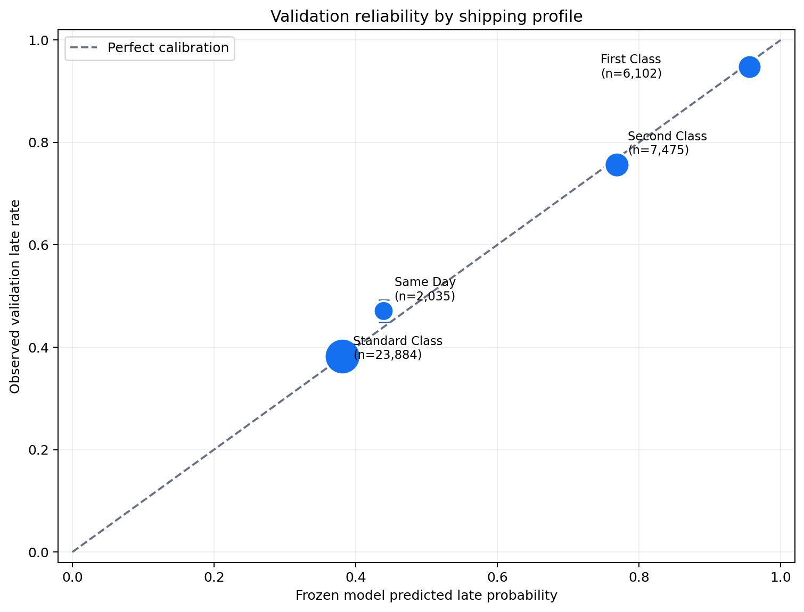
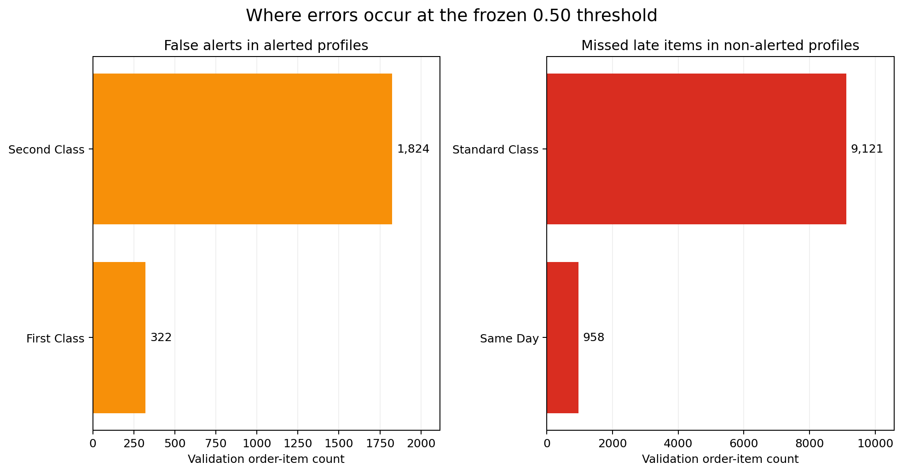

# Validation Calibration and Error Analysis

## Purpose and guardrails

This analysis checks whether the frozen depth-3 tree's reported late-delivery
probabilities agree with observed outcomes and identifies where its alert errors
occur. It uses only the validation profiles already recorded in
`reports/final_evaluation.json`. It does not fit a calibrator, select a model,
change a feature, tune the 0.50 alert threshold, or use test results to make a
decision.

Before calculating anything, the analysis verifies the frozen configuration
hash, feature list, threshold, model fingerprint, validation totals, and the
pre-test scoring guarantees recorded by the existing evaluation workflow.

## Method

The tree produces four distinct probability scores, one for each approved
shipping profile. Calibration is therefore assessed across those four score
groups and weighted by validation order-item count. The analysis reports:

- observed late rate and a 95% Wilson interval for each profile;
- Brier score and improvement over a prevalence-only probability forecast;
- expected calibration error (item-weighted absolute profile gap);
- maximum absolute profile calibration gap; and
- false alerts and missed late items at the frozen inclusive 0.50 threshold.

## Results

| Shipping profile | Items | Predicted late | Observed late | Observed minus predicted | Decision | False alerts | Missed late items |
|---|---:|---:|---:|---:|---|---:|---:|
| Same Day | 2,035 | 43.95% | 47.08% | +3.12 pp | No alert | 0 | 958 |
| First Class | 6,102 | 95.63% | 94.72% | -0.91 pp | Alert | 322 | 0 |
| Second Class | 7,475 | 76.90% | 75.60% | -1.30 pp | Alert | 1,824 | 0 |
| Standard Class | 23,884 | 38.15% | 38.19% | +0.04 pp | No alert | 0 | 9,121 |

Across 39,496 validation order-items, the mean predicted probability was
54.66% and the observed late prevalence was 54.46%, a difference of +0.20
percentage points. The Brier score was 0.1983 versus 0.2480 for a
prevalence-only forecast, a 20.04% Brier skill improvement. Expected
calibration error was 0.57 percentage points, and the largest profile gap was
3.12 percentage points for Same Day.

These results show close profile-level probability alignment, but calibration
does not remove the model's limited within-profile discrimination. Standard
Class contains 60.47% of validation items and accounts for 9,121 of 10,079
missed late items (90.50%). Second Class accounts for 1,824 of 2,146 false
alerts (85.00%). The error concentration follows directly from applying one
decision to every item within each of the four profiles.





## Business interpretation and recommendations

The scores are useful for profile-level risk ranking and workload planning:
First Class and Second Class are high-risk groups, while Same Day and Standard
Class are not alerted at the frozen threshold. Operations should not interpret
an individual item's score as a causal or individualized diagnosis because all
items in a shipping profile receive the same prediction.

For this submission, keep the frozen model and threshold unchanged and report
the concentrated error burden transparently. In future work, monitor observed
late rates by shipping profile for drift. Meaningful improvement would require
approved pre-order features that distinguish items within a profile, followed
by a newly frozen validation protocol and a genuinely untouched test set.

The supplemental order-level report provides scale, not tuning evidence. At
the unchanged threshold, the final test partition contains 698 false-alerted
orders and 3,345 missed late orders.

## Limitations

- Only four distinct scores are available, so this is grouped calibration, not
  a fine-grained reliability assessment.
- The calibration metrics are order-item weighted; repeated items from one
  order can be correlated.
- Wilson intervals quantify sampling uncertainty within each profile but do not
  account for temporal drift or order-level clustering.
- Test results are repeated only as final descriptive context and were not used
  for calibration, threshold selection, or recommendations about model choice.

## Reproduce

From the repository root in the pinned Conda environment:

```bash
conda env create -f environment.yml
conda activate cap3764-team4
python -m src.calibration_analysis
pytest -q
```

Machine-readable results are in `reports/calibration_analysis.json` and
`reports/calibration_analysis.csv`.
