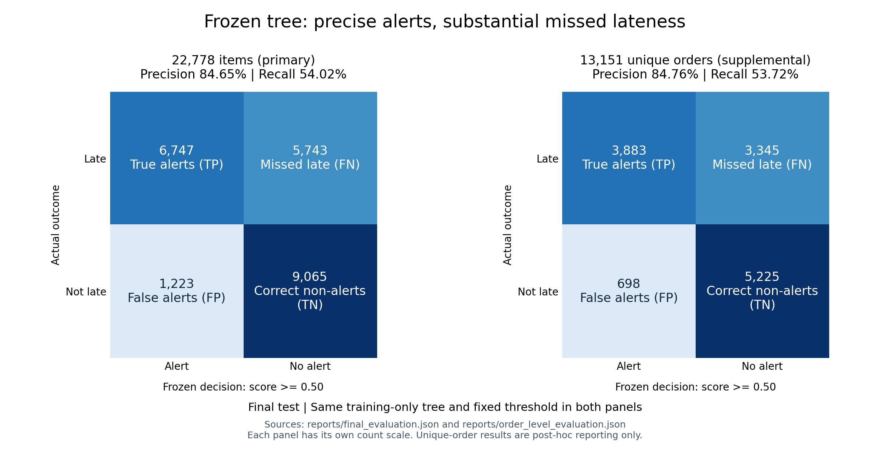

# Frozen model comparison and interpretation

Generated from tracked reports by `python -m src.model_interpretation`; no customer data is required.

## What was compared

AP (average precision) measures ranking across thresholds. Precision is the share of alerts that are late; recall is the share of late cases alerted. AP is not precision at 0.50.

| Stage | Unit | Model | Observations | AP | Precision at 0.50 | Recall at 0.50 |
|---|---|---|---:|---:|---:|---:|
| Inner training folds (mean) | Item | Logistic regression (C=0.1) | — | 0.754742 | — | — |
| Inner training folds (mean) | Item | Selected depth-3 tree | — | 0.754742 | — | — |
| Inner training folds (mean) | Item | Random forest (depth 3) | — | 0.754742 | — | — |
| Validation | Item | Existing depth-3 tree | 39,496 | 0.742000 | 84.19% | 53.14% |
| Validation | Item | Logistic regression (C=0.1) | 39,496 | 0.742000 | 84.19% | 53.14% |
| Validation | Item | Selected depth-3 tree | 39,496 | 0.742000 | 84.19% | 53.14% |
| Validation | Item | Random forest (depth 3) | 39,496 | 0.742000 | — | — |
| Validation | Item | Always late | 39,496 | 0.544612 | 54.46% | 100.00% |
| Final test (frozen) | Item | Frozen depth-3 tree | 22,778 | 0.749683 | 84.65% | 54.02% |
| Final test (frozen) | Item | Always late | 22,778 | 0.548336 | 54.83% | 100.00% |
| Validation (supplemental) | Order | Frozen depth-3 tree | 13,150 | 0.745603 | 84.72% | 53.49% |
| Final test (supplemental) | Order | Frozen depth-3 tree | 13,151 | 0.749332 | 84.76% | 53.72% |

- Inner CV AP is the unweighted mean of three per-item fold APs within outer training; no single observation count applies.
- Compare models within the same stage and unit. Different periods and weighting are not a controlled model comparison.
- Null/blank values mean unreported or inapplicable, never zero. Random-forest threshold metrics were not reported.
- Tree reference and selected tree candidate share the frozen configuration; they are not independent models.
- Logistic threshold metrics map the already-fixed 0.50 threshold into its tracked validation policy interval; no policy selection occurs.
- Unique-order results are post-hoc supplemental reporting, not model selection evidence.

The bounded historical search selected settings using only three expanding chronological folds within outer training, preserving whole orders. Validation and final test cover later, separate periods. The inner-fold mean is not a validation or final-test score. Item weighting gives multi-item orders more influence; the supplemental order unit weights each order once.

## Why retain the tree

The selected logistic regression, decision tree, and random forest tie exactly on validation AP. With the two approved inputs, shipping mode and scheduled duration define four observed profiles, and all selected candidates rank them First Class > Second Class > Same Day > Standard Class. Different score values therefore produce the same AP; the tie does not establish that the tree is more accurate.

The earlier AutoML preference for logistic regression came from its predeclared family tie rule, not superior performance. The later frozen configuration records the team's explicit choice of the existing tree before final-test scoring. A depth cap of 3, minimum leaf size of 100 training items, and seed 42 give a compact, reproducible four-leaf structure. Its stable profile ranking across the compared candidates, readable decisions, and operational simplicity justify retaining it without an AP gain from the forest. This does not establish statistical stability under future distribution changes.

Only `days_for_shipment_scheduled` and `shipping_mode` are predictors. IDs and timestamps preserve order groups and chronology. Outcome fields and identifying fields are excluded. Preprocessing and the tree were fitted on training only; validation was not added to training.

## What the decisions mean

The frozen rule alerts when late-class probability is **greater than or equal to 0.50**, including equality. This threshold was fixed before test scoring; it was not optimized for business costs. Earlier tree/policy documents describe an illustrative or undecided threshold because they precede the frozen configuration.

| Observed shipping profile | Scheduled days | Training-derived tree late score | Alert at 0.50 |
|---|---:|---:|---|
| First Class | 1 | 0.956305 | Yes |
| Second Class | 2 | 0.769035 | Yes |
| Same Day | 0 | 0.439531 | No |
| Standard Class | 4 | 0.381484 | No |

Source: `reports/validation_alert_policies.json`, tree profile probabilities. These are training leaf proportions, not calibrated deployment risks or observed test late rates. The table describes observed profiles; it does not establish behavior for unknown or inconsistent future combinations. No causal claim about shipping choices follows from these associations.

On final test, the tree issued 7,970 item alerts: 6,747 true alerts and 1,223 false alerts. It missed 5,743 late items and correctly left 9,065 non-late items unalerted. Precision was 84.65% and recall 54.02%, so 45.98% of late items were missed.



**Figure:** Actual outcomes are rows; alert decisions are columns. Left: the frozen primary evaluation, one vote per item. Right: post-hoc supplemental reporting, one vote per order. Counts come directly from the respective tracked final-evaluation reports. Each panel uses its own count scale; compare rates in the table rather than cell colors across panels.

The supplemental order view gives 84.76% precision and 53.72% recall, with 3,345 of 7,228 late orders missed (46.28%). The policy produces comparatively precise alerts while missing roughly 46% of late orders. Item counts must not be described as unique interventions.

Always-late catches every late case by alerting on everything; the tree reduces false alerts at the cost of missed late deliveries. Lower thresholds historically added whole shipping profiles, increasing recall and alert volume together. No documented intervention budget or false-alert/miss costs establish that 0.50 is economically optimal. No new threshold, model, feature, calibration, or preprocessing choice is proposed here.

The model cannot distinguish risk within a shipping profile. Scores are uncalibrated, earlier full-data EDA was disclosed, and these results do not demonstrate causality, statistical significance, or future deployment performance. The final test has already been examined; a future candidate requires a new protocol with an untouched test set.

## Reproduce and hand off

Run in the existing `cap3764-team4` environment from the repository root:

```bash
python -m src.model_interpretation
pytest -q tests/test_model_interpretation.py
pytest -q
```

The command writes only the new comparison JSON/CSV, this document, and the modeling figure. It reads tracked JSON; it imports no evaluation runners and performs no model fitting or prediction. JSON retains full stored precision and source pointers; CSV uses blanks for unavailable values. Tests check the displayed tables against sources and compare the generated document to this tracked copy.

Sources (the JSON is authoritative; paired CSVs round floating values to 12 decimals):

- [reports/always_late_validation.json](../reports/always_late_validation.json)
- [reports/tree_validation.json](../reports/tree_validation.json)
- [reports/automl_validation.json](../reports/automl_validation.json)
- [reports/validation_alert_policies.json](../reports/validation_alert_policies.json)
- [reports/final_evaluation.json](../reports/final_evaluation.json)
- [reports/order_level_evaluation.json](../reports/order_level_evaluation.json)
- [docs/FINAL_MODEL_CONFIG.json](../docs/FINAL_MODEL_CONFIG.json)

Paired source tables checked by tests: `reports/automl_leaderboard.csv`, `reports/validation_alert_policies.csv`, `reports/final_evaluation.csv`, and `reports/order_level_evaluation.csv`.

Person 2 should reuse `reports/model_comparison.csv`, the figure above, and the following verified interpretation:

> The depth-3 tree was retained because it gives the same validation ranking as logistic regression and random forest with a compact, interpretable decision structure. At the frozen 0.50 threshold it alerts for First Class and Second Class shipping. Its alerts are comparatively precise, but it misses roughly 46% of late orders, so it supports prioritization rather than comprehensive detection.
